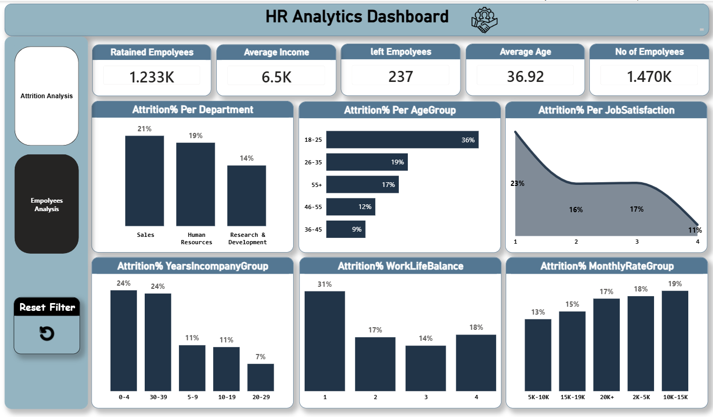
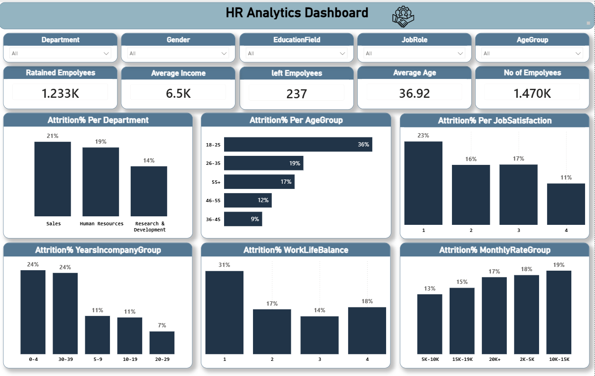

# 👥 HR Analytics: Employee Attrition Dashboard

### Why do employees leave, and what can we do about it?

---

## 🎯 The Problem

Employee turnover is expensive. Replacing someone costs time, money, and lost knowledge. This project digs into an HR dataset of **1,470 employees** to find out **who is leaving, and why**, so HR can act before it happens.

---

## 📸 Dashboard Preview

  

---

## 🔍 What I Analyzed

- 📉 **Attrition rate** overall and by department
- 👤 **Age groups**: which ages leave the most
- 😊 **Job satisfaction** and its link to leaving
- ⚖️ **Work-life balance** impact on attrition
- 📅 **Years in company**: how long people stay before leaving
- 💰 **Monthly rate groups** vs. attrition

---

## 📊 Headline Numbers

| Metric | Value |
|:---|:---:|
| Total employees | **1,470** |
| Employees who left | **237** (about 16%) |
| Retained employees | **1,233** |
| Average age | **36.9** |

---

## 💡 Key Insights

- **Young employees leave the most:** the 18-25 group has a **36%** attrition rate, almost double the next group (19%).
- **Sales has the highest attrition by department:** **21%**, compared to 14% in Research & Development.
- **Poor work-life balance is a red flag:** employees who rated it 1 leave at **31%**, versus 14% for those who rated it 3.
- **Satisfaction matters:** the lowest satisfaction score (1) goes with **23%** attrition, while the highest (4) drops to **11%**.
- **The first years are the riskiest:** employees with 0-4 years in the company leave at **24%**, falling to 7% for long-tenured staff.

### ✅ Recommendations
- Build onboarding and mentoring programs focused on employees under 26
- Review workload and flexibility in the Sales department
- Track work-life balance and satisfaction scores as early-warning signals

---

## 🛠️ Tools & Workflow

| Step | Tool | What I did |
|:---|:---|:---|
| 1️⃣ Clean | Excel | Checked data quality, handled errors |
| 2️⃣ Model | Power BI | Built relationships and DAX measures |
| 3️⃣ Visualize | Power BI | Designed an interactive dashboard with KPI cards and filters |

---

## 🚀 How to Explore It

1. Download `HR_Analytics.pbix` from this repo
2. Open it in **Power BI Desktop**
3. Use the slicers to filter by department, gender, job role, and more

The raw data is in `HR_Analytics.csv`.

---

## 📬 Let's Connect

⭐ *If you liked this project, drop a star!*

